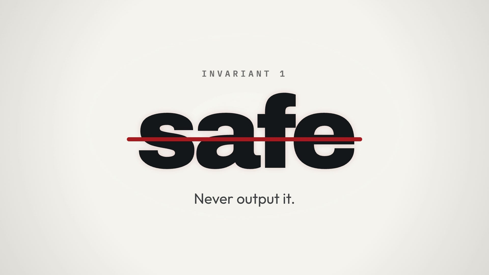

<!-- TODO: add a banner/logo image here once one exists. -->

# SoroSentinel Guard

[](https://github.com/SoroSentinel/Sorosentinel-guard/actions/workflows/ci.yml)
[](https://scorecard.dev/viewer/?uri=github.com/SoroSentinel/Sorosentinel-guard)


[](LICENSE)

Guard is a TypeScript SDK that a wallet calls just before a user signs. It decodes the exact transaction bytes being signed, works out what each operation does to each account (balances, signers, trustlines, contract authorizations), checks counterparties against SoroSentinel's signed snapshot, or Intel's API when no snapshot settled them, and returns findings ordered by severity. It never sees private keys and never reports a transaction as "safe": the best result is "no issues found" plus a list of what was not checked.

Part of **SoroSentinel**, security tooling for the Stellar ecosystem. It advises; it never controls the network and never touches private keys.

## Watch it work

[](media/sorosentinel-guard.mp4)

No real account, contract or transaction appears in it; the address and amounts are demo values. The card it shows is what `analyze()` returns — a Critical and a High finding in severity order, the worst-case balance effect per account, and the list of what was not checked. The struck-through word in the first beat is the one Guard is not allowed to output; its best possible result is `no_issues_found`.

Music: ["Business Moves Vol. 12"](https://www.ende.app) by Sascha Ende, used under CC BY 4.0.

## Maintainers | [Telegram](TODO-telegram-group-link)

| Maintainer | GitHub | Contact |
|---|---|---|
| TODO name | [@TODO](https://github.com/TODO) | [Telegram](https://t.me/TODO) |

## Community

Questions and coordination: [Telegram group](TODO-telegram-group-link).

## How the pieces fit

| Repo | Language | Role |
|---|---|---|
| [Sorosentinel-intel](https://github.com/SoroSentinel/Sorosentinel-intel) | Go | Evidence, detectors, signals, API, signed snapshot, shared schemas |
| [Sorosentinel-guard](https://github.com/SoroSentinel/Sorosentinel-guard) | TypeScript | Pre-signing transaction analysis SDK for wallets |
| [Sorosentinel-scan](https://github.com/SoroSentinel/Sorosentinel-scan) | Rust | Static triage of deployed Soroban WASM |

Data flows Scan → Intel → signed snapshot/API → Guard. The repos only talk through versioned schemas owned by Intel.

## Status

Phase 1 complete in code. `analyze()` / `analyzeAsync()` decode exactly the signed bytes, derive per-account balance and account effects (worst case first), simulate Soroban calls through a caller-supplied RPC endpoint, verify Intel's signed snapshot and look up counterparties — or ask Intel's read API when no snapshot settled them — and report findings: G-ACCOUNT-CONTROL, G-SIGNER-ADDED, G-NO-EXPIRY, G-NETWORK-UNKNOWN, G-MEMO-REQUIRED, G-DEST-FLAGGED, G-TRUST-FLAGGED, G-CONTRACT-FLAGGED. Findings carry facts only until their wording is counsel-approved. Experiment E2 has run over 12,000 real mainnet transactions and 12,000 testnet ones: all decoded, none `unanalyzable`. Not yet: the Protocol 30 SDK upgrade, and E2's benign-warning rate, which needs the labeled corpus.

## Quick start

Prerequisites: Node.js 22.12+ and pnpm 10.34.7 (`corepack enable pnpm` installs the pinned, hash-checked version).

```bash
git clone https://github.com/SoroSentinel/Sorosentinel-guard.git
cd Sorosentinel-guard
make deps
make verify
```

| Command | What it does |
|---|---|
| `make verify` | Strict typecheck, tests, fixtures-up-to-date check |
| `make test` | Vitest |
| `make gen` | Regenerate `fixtures/tx` (never edit fixtures by hand) |
| `make replay FILE=txs.jsonl` | Decode a file of transactions and print aggregate stats |
| `make bench` | Measure `analyze` latency against the PRD §7 targets (local path only, no network) |
| `make bench RPC=https://…` | Also measure the end-to-end path with RPC simulation; sends invocation envelopes to that endpoint |
| `node packages/core/scripts/export-rpc-txs.ts --url …` | Export recent transactions from an RPC endpoint for `make replay` (writes the gitignored `replay/`) |

## Wallet integrator guide

A step-by-step path from a fresh clone to a signing prompt. Every command and every output below was run on 2026-10-29 against Node 26 (CI runs Node 24) with `main` at commit `1e894b1`, following this text with nothing but the repository checked out.

### What Guard never does

Worth stating before the setup steps, because a wallet's threat model depends on it.

| Guard never… | Which means |
|---|---|
| touches a private key | It accepts an envelope — usually unsigned — and returns a struct. It does not sign, submit, or block anything. The decision stays with the user. |
| phones home | `analyze()` makes **no** network calls at all. `analyzeAsync()` calls only the endpoints *you* configure: the RPC endpoint, and Intel's API if you set `intel`. There is no telemetry, no analytics, no default endpoint baked in. |
| says "safe" | The best status is `no_issues_found`, always alongside `notChecked`: what was not examined is part of the answer. |
| truncates findings | All findings, most severe first. A host that shows the top three has thrown away the guarantee. |
| reads the clock | `asOf` comes from the caller, so the same `(input, asOf, ruleset)` gives the same result. Omit it and time-relative checks are skipped, not guessed. |
| sends your transaction anywhere | Counterparty checks run against a snapshot file you already downloaded. Nothing leaves the device unless you configure `rpc` or `intel`, and even `intel` sends only the entity keys it is asking about — never the transaction, its XDR or its hash. |

### 1. Install

`@sorosentinel/guard-core` is `"private": true` in `packages/core/package.json` and is **not published to npm**. Consume it from source for now — by vendoring the repo, or by pointing your bundler at `packages/core/src/index.ts` (it is ESM TypeScript, run through Node's built-in type stripping).

```bash
corepack enable pnpm          # pins pnpm 10.34.7 by sha512 from package.json
git clone https://github.com/SoroSentinel/Sorosentinel-guard.git
cd Sorosentinel-guard
make deps
make verify                   # typecheck + tests + Intel's pinned vectors
```

`package.json` declares `engines.node: >=22.12.0`, but unflagged type stripping is not available in every 22.x. If `node <file>.mts` fails on an unknown file extension, use Node 24 (what CI runs) rather than passing a flag.

### 2. Run it once, from the artifacts in this repo

No external services, no keys, no accounts. The pinned Intel signing vector supplies a real snapshot, and the committed fixtures supply a real envelope.

```bash
V=$(mktemp -d)
export TMPDIR_SNAP="$V/snapshot.json"
export TMPDIR_TX="$V/tx.b64"

node -e '
  const fs = require("node:fs");
  const v = JSON.parse(fs.readFileSync("intel-schemas/snapshot_signing.json", "utf8"));
  fs.writeFileSync(process.env.TMPDIR_SNAP, JSON.stringify(v.snapshot, null, 2));
  console.log("key_id=" + v.snapshot.key_id);
  console.log("public_key=" + v.public_key_hex);
'
node -e '
  const fs = require("node:fs");
  fs.writeFileSync(process.env.TMPDIR_TX,
    JSON.parse(fs.readFileSync("fixtures/tx/hostile/hashx_signer.json", "utf8")).xdr);
'
```

Expected output: `key_id=test-key-1` and `public_key=ea4a6c63e29c…` (the vector's own 64-hex public key). That vector is Intel's committed test signing vector: its seed is documented as a test key, so the **format and the signature are real while the trust is not** — a snapshot signed by a production key verifies through exactly the same code.

```bash
node examples/analyze-transaction/analyze.mts \
  --network public --snapshot "$TMPDIR_SNAP" \
  --key-id test-key-1 --public-key ea4a6c63e29c520abef5507b132ec5f9954776aebebe7b92421eea691446d22c \
  --xdr-file "$TMPDIR_TX" --as-of 2026-10-27T00:01:00Z
```

```text
status: findings_present
tx_hash: e785adde762d0d03a687fdc36e6fccc452f19f01871f5e81c7db79a0f9bc0d60
network: public
operations: 1
snapshot: verified
effects: 1
  GCFIRY65… native delta_min=-100 delta_max=0 assurance=ledger
findings: 1
  critical G-SIGNER-ADDED op=0 account=GCFIRY65… signer=XAEQSCIJ… signer_type=hash_x weight=1
not_checked: NC-EXECUTION-TIME
```

Every field above is verbatim except the two account strings and the hash-x signer, which are the fixture's own test-vector keys and are shown elided here so the guide never reads like it is carrying a real user's address. Compare the prefixes and the numbers; `delta_min=-100` is the worst case in stroops, and it is the line that tells a wallet how much the transaction can take.

Drop `--as-of` and the same command prints `snapshot: stale`, `status: partial` and `not_checked: NC-COUNTERPARTY-SIGNALS, NC-EXECUTION-TIME` — the vector's snapshot was generated 2026-10-27 and the default `asOf` is now. That is the behaviour you have to reproduce in your own UI, so it is worth seeing deliberately.

### 3. Configure a call

`analyze(xdr, ctx)` takes one `ctx`, and every field in it is a decision you have to make:

```ts
import { analyze, analyzeAsync } from "./packages/core/src/index.ts";
import type { AnalyzeContext } from "./packages/core/src/index.ts";

const ctx: AnalyzeContext = {
  networkPassphrase: "Public Global Stellar Network ; September 2015",
  asOf: new Date(),
  snapshot: { data: snapshotJson, pinnedKeys: { "key-id": publicKeyBytes } },
  rpc: { url: "https://rpc.example", timeoutMs: 5_000 },   // analyzeAsync only
  intel: { url: "https://intel.example" },                  // analyzeAsync only, optional
};
```

| Field | Notes |
|---|---|
| `networkPassphrase` | Which network you will sign **for**. Guard reads the passphrase off the envelope itself; this is the expected value. Anything it does not know (standalone, a fork) becomes `network: "unknown"` + `G-NETWORK-UNKNOWN` and never a clean result. |
| `asOf` | Caller-supplied reference time. Required for a snapshot to be consulted at all: without it `snapshotStatus` is `no_as_of` and counterparties go unchecked. |
| `snapshot.pinnedKeys` | Map of key id → 32 raw public key bytes, pinned in **your** build. A snapshot whose `key_id` is not in the map is not used. Guard verifies the Ed25519 signature itself; it never trusts an unsigned snapshot. |
| `snapshot.maxAgeSeconds` | Optional; defaults to 3600. Past it, `snapshotStatus: "stale"` — surface that as "protection data stale", not as silence. |
| `rpc.url` | The endpoint `analyzeAsync` contacts for simulation and SEP-29 lookups. HTTPS enforced. Nothing else receives data. |
| `intel.url` | Optional. Intel's read API, used by `analyzeAsync` **only** when no snapshot settled the counterparties — a fresh snapshot that named every entity is the answer, and nothing is sent. HTTPS is enforced here too, and more strictly: a snapshot carries a signature, an API reply does not, so transport integrity is the only thing that says the answer came from Intel. Guard sends one `POST /v1/entities:batchGet` with the network, type and key of each counterparty (100 at most) and nothing else. Any timeout, HTTP error or unexpected reply leaves `NC-COUNTERPARTY-SIGNALS`: the fallback can only add findings, never remove the gap. |
| `intel.timeoutMs` | Same transport rules as `rpc`: default 10 s, refused above 60 s rather than truncated. |

Fetch a snapshot from Intel — `network` is a **required** query parameter (`schemas/openapi/intel.v1.yaml` in Intel, `/v1/snapshots/latest`, operation `getLatestSnapshot`):

```bash
curl -fsS 'https://<intel-host>/v1/snapshots/latest?network=public' -o snapshot.json
```

Today Intel signs snapshots with an interim key file, not a KMS: ADR 0006 chose Cloud KMS Ed25519, and the KMS signer itself is Intel issue #34, still gated on approval. So pin the key id and public key you receive out-of-band from Intel, and expect to change them.

The rotation design (ADR 0006, Intel ARCHITECTURE OE4) keeps **two active key ids** with a keyset pinned in Guard and a revocation list in the release — which is why `pinnedKeys` is a map rather than a single key: you can pin the incoming key before the outgoing one is retired, and a snapshot signed by a key you have revoked simply does not verify. There is no rotation runbook yet; Intel's `docs/project_structure.md` lists `runbooks/snapshot-key-rotation.md` as intended but unwritten.

### 4. Handle every status

Four statuses, and the contract is that a host must render all four. [ADR 0005 (draft)](docs/adr/0005-guard-integrator-contract.md) is that contract: six things a host must show, none of them suppressible. It is still a draft, and its open questions include who enforces it. Guard's reference host is `examples/analyze-transaction/analyze.mts`, and `packages/core/test/example.test.ts` drives it over fixtures so the reference cannot quietly shrink into the tidy case — read that test as the executable version of this table.

| `status` | What it means | What the UI must do |
|---|---|---|
| `findings_present` | At least one finding. | Show **all** findings, worst first, with `operationCount` and `txHash`. |
| `no_issues_found` | Everything applicable was checked and nothing fired. | Show it **with** `notChecked`. Absence of data ≠ safety. |
| `partial` | Something could not be checked — stale snapshot, simulation failed, an operation with no derived effects. | Still show findings, and name the gap. Never collapse to "no issues". |
| `unanalyzable` | The envelope did not decode (`decode_failed`, `input_too_large`, `invalid_network_passphrase`). | Stop and tell the user it could not be analyzed. `txHash` is `null`; there is no operation count. |

Two rules fall out of that table and are the ones integrators most often break:

- **`partial` is not `no_issues_found`.** If you render `findings.length === 0` as "all clear", a stale snapshot becomes a false reassurance — the exact failure the product exists to prevent.
- **`unanalyzable` must still block the flow.** `analyze()` never throws, so there is no exception to catch. If you only branch on `findings_present`, an undecodable transaction sails through.

`notChecked` codes you will see: `NC-DECODE`, `NC-EXECUTION-TIME` (always — behavior at landing can differ from what was simulated), `NC-COUNTERPARTY-SIGNALS`, `NC-OPERATION-EFFECTS`, `NC-SIMULATION`, `NC-NETWORK-COVERAGE`, `NC-MEMO-REQUIRED`.

For the latency budget, `analyze` is synchronous and takes no network: measured at p95 **1.4 ms** over 35 fixtures with a verified snapshot. `analyzeAsync` adds the simulation round trip — p95 **454 ms** in one testnet run, where the network was essentially the whole cost. Intel's `docs/runbooks/guard-latency-baseline-2026-10.md` has the record and the caveats.

### 5. Findings text: today you show facts, not prose

`Finding.statement` is typed `null`, and that is not a placeholder. Public prose comes only from the wording renderer (`packages/core/src/wording/render.ts`), which refuses any template that is not counsel-approved — and as of 2026-10-29 **all twelve** Intel templates and the standard attribution are `status: draft` (`wording/templates/en/*.yaml`, Intel issue #32).

Feeding the real `tx.signer_added.v1` template to the renderer returns exactly:

```json
{"ok":false,"error":{"code":"not_approved","detail":"template tx.signer_added.v1 is draft"},
 "facts":{"account":"G…","signer":"X…","weight":"1","as_of":"2026-10-27T00:01:00Z"}}
```

So the fail-closed path is not a hypothetical you should defend against later; it is the only path today. Render `facts` as structured data (a table of account/signer/weight), and **do not write your own sentences about what the transaction means** — inventing wording in the wallet is what G-12 exists to avoid, and `statement` will start filling in when Intel #32 lands without your code changing.

When it does, the call is `Renderer.create(registry, { methodologyUrl, reviewUrl }).render({ templateId, severity, asOf, method, rulesetVersion, slots })`, with `slotValue(type, raw)` for typed slots. There is deliberately no free-text slot type.

You do not have to build the display yourself. `renderFindings(result, { doc, statementFor?, labels?, headingLevel? })` from `packages/core/src/ui/findings.ts` (exported from the package index) is the reference view for PRD G-12: one plain-DOM `<section role="region">` that writes **no prose of its own**. Its only text is field names (`DEFAULT_LABELS`, overridable), every value reaches the DOM through `createTextNode` after `sanitizeUntrusted`, nothing untrusted becomes a link, and `assurance` is shown as the code rather than as "ledger" when it is not. Omit `statementFor`, or let a render fail, and it falls back to the finding's structured facts — which is what the draft-template state above produces. `node packages/core/scripts/demo-findings.ts` writes a page of every display state (many operations, a critical finding, an unbounded delta, a merge) under `$TMPDIR` — pass a path to choose one, `--with-wording` to render the templates — so you can read the markup in a browser; `packages/core/test/ui-findings.test.ts` is the executable version of the contract.

### 6. Data handling in your UI

- **Amounts are `bigint` stroops** — 7 decimal fixed point, never a float. `deltaMax: null` means *unbounded*, which is the case a user most needs to see; show the worst side first ("up to X").
- **`assurance`** is `"ledger"` or `"contract_reported"`. The second came from contract event data, not the ledger, and must never be presented as ledger truth.
- **Asset codes, memos, domains and any other string from the transaction are attacker-chosen.** Run them through `sanitizeUntrusted` (strips control and bidi characters, caps display length) before they reach the DOM or a terminal, use `escapeHtml` for HTML, and never linkify.
- **Do not log raw XDR or user addresses by default** (AGENTS.md §6). The example prints them because it is a local CLI over fixtures; a production host should not.
- Findings are ordered and complete: render `r.findings` in full, never `slice(0, 3)`.

### 7. Before you ship

- [ ] `partial` and `unanalyzable` each produce a visible state, and neither reads as "no issues".
- [ ] A non-`verified` `snapshotStatus` is surfaced — `stale` in particular is the "protection data stale" state, not a silent downgrade.
- [ ] Every finding renders, with `operationCount` and `txHash` (for a fee bump, the inner hash — the one that is actually signed).
- [ ] Your build pins the snapshot key id and public key, and you have a plan for rotation.
- [ ] The RPC endpoint is one you configure and audit, and so is `intel` if you set it; nothing else leaves the device.
- [ ] Amounts are `bigint`, worst case first, and `assurance` is distinguished.
- [ ] Untrusted strings are sanitized; no wording of your own describes a transaction. If you render the view rather than use `renderFindings`, `packages/core/test/ui-findings.test.ts` lists what it already guarantees.
- [ ] `make verify` passes in your fork, and Intel's pinned vectors still pass (they are the contract).

## Repository layout

| Path | What |
|---|---|
| `packages/core/src/decode/` | Envelope and operation decoder |
| `packages/core/scripts/` | Fixture generator, replay harness, latency benchmark |
| `fixtures/tx/` | Generated benign and hostile transaction fixtures |
| `docs/` | Generated copies of the canonical docs (edit them in Intel) |

## Contributing

Pick an open issue (Wave issues carry the `Stellar Wave` label), comment to be assigned, then follow [CONTRIBUTING.md](CONTRIBUTING.md). Every PR must pass `make verify`. AI coding agents must follow [AGENTS.md](AGENTS.md).

## Security

Do not open public issues for vulnerabilities. See [SECURITY.md](SECURITY.md). This code is **not audited**.

## Contributors

[](https://github.com/SoroSentinel/Sorosentinel-guard/graphs/contributors)

## License

Licensed under the [Apache License, Version 2.0](LICENSE).
